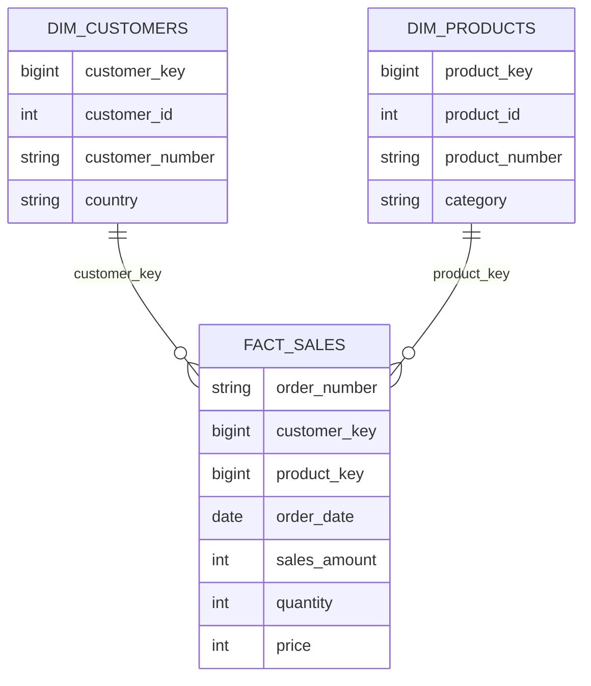

# Arquitectura y modelo de datos

## Alcance
Este documento describe el código disponible. No afirma ejecución satisfactoria ni volúmenes procesados. El proyecto parte de un ejercicio guiado de Data with Baraa; las decisiones descritas no se atribuyen como diseños originales del autor del repositorio.

## Flujo por capas
| Origen | Bronze | Silver | Consumo Gold |
| --- | --- | --- | --- |
| CRM: clientes | crm_cust_info | crm_cust_info | dim_customers |
| ERP: clientes | erp_cust_az12 | erp_cust_az12 | dim_customers |
| ERP: ubicación | erp_loc_a101 | erp_loc_a101 | dim_customers |
| CRM: productos | crm_prd_info | crm_prd_info | dim_products |
| ERP: categorías | erp_px_cat_g1v2 | erp_px_cat_g1v2 | dim_products |
| CRM: ventas | crm_sales_details | crm_sales_details | fact_sales |

## Modelo de consumo

Las relaciones representan el modelo lógico esperado. Las vistas no imponen claves primarias ni foráneas: hay que verificar unicidad y correspondencia mediante consultas.

### Granularidad
- **Clientes:** una fila esperada por cliente, después de deduplicar CRM e integrar ERP. Si ERP contiene varias coincidencias por clave, el JOIN puede multiplicar filas.
- **Productos:** una fila esperada por clave de producto vigente. La unicidad debe validarse.
- **Ventas:** se conserva cada registro del detalle comercial de Silver. El número de orden, por sí solo, no se considera una clave única.

## Reglas observables
| Entidad | Regla presente | Consideración |
| --- | --- | --- |
| Clientes | ROW_NUMBER por ID, priorizando fecha de creación descendente | Excluye ID nulo; desempata con columnas adicionales |
| Clientes | TRIM, UPPER y CASE | Estandariza género y estado civil |
| Productos | Separación de categoría y clave desde prd_key | Depende del formato del identificador |
| Productos | Costo nulo a cero | Cero es una regla del ejercicio; no equivale siempre a costo conocido |
| Productos | LEAD para fecha final | Requiere revisar fechas duplicadas y orden de vigencia |
| Ventas | Fechas cero o de longitud distinta a ocho a NULL | Una fecha de ocho dígitos aún puede fallar al convertirse |
| Ventas | Recálculo de ventas y precio | Las expresiones leen valores de origen, no el alias calculado en el mismo SELECT |
| ERP | Limpieza de prefijos y separadores de claves | Permite cruces con CRM; validar colisiones |
| País | Normalización de códigos conocidos | Revisar espacios y códigos no contemplados |

## Decisiones y límites
### Recarga completa
Bronze y Silver usan TRUNCATE seguido de carga. Facilita la práctica, pero un fallo puede dejar capas parcialmente cargadas. No existe control transaccional de toda la ejecución.

### Gold como vistas
Evita un procedimiento adicional de carga Gold y permite consultar Silver a través de un modelo común. No materializa el modelo ni conserva una instantánea independiente.

### Claves con ROW_NUMBER
Las claves de dimensión se calculan al consultar. No son claves sustitutas persistentes: insertar o eliminar filas puede cambiar la numeración. No deben almacenarse fuera de estas vistas como identificadores estables.

### Productos vigentes
Gold filtra productos con fecha final nula. El modelo no realiza un JOIN temporal para asociar cada venta con la versión histórica del producto.

### Manejo de errores y duración
TRY/CATCH imprime información y los tiempos se muestran con PRINT. No hay log persistente ni propagación del error al ejecutor.

## Evidencia por completar
Los resultados deben registrarse a partir de una ejecución real. No utilizar cifras de ejemplo como resultados del proyecto.

| Control | Resultado real |
| --- | --- |
| Conteo de filas de las seis tablas Bronze | Pendiente |
| Conteo de filas de las seis tablas Silver | Pendiente |
| Duplicados por clave en dimensiones Gold | Pendiente |
| Ventas sin cliente o producto | Pendiente |
| Consistencia entre importe, cantidad y precio | Pendiente |
| Duración por capa | Pendiente |
